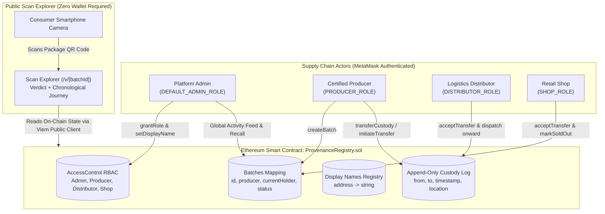

# ProvenanceChain

> **Role-Based Product Authenticity & Custody Provenance on Ethereum**  
> Enforcing tamper-proof supply chain custody handovers on-chain with MetaMask, Next.js, and OpenZeppelin smart contracts. Zero database — 100% blockchain as the single source of truth.

---

## 1. System Overview

Counterfeit and adulterated products (such as single-origin specialty coffee, baby formula, olive oil, and pharmaceuticals) cost billions annually and pose serious health risks. Centralized supply chain tracking systems rely on closed databases that can be quietly altered, backdated, or fabricated by malicious insiders or compromised API credentials.

**ProvenanceChain** solves this by enforcing immutable, cryptographically signed handovers directly on the Ethereum blockchain:

1. **Role-Enforced Custody Transitions**:
   $$\text{Producer} \longrightarrow \text{Distributor} \longrightarrow \text{Retail Shop}$$
   $$\text{Producer} \longrightarrow \text{Retail Shop (Direct)}$$
   $$\text{Distributor} \longrightarrow \text{Distributor (Multi-Tier Logistics)}$$
   Any unauthorized custody transfer (e.g. Shop &rarr; Producer or random unauthorized wallet) reverts at the EVM contract level.

2. **Dual Handover Engine**:
   - **⚡ Direct Transfer**: Transfers custody and appends an immutable `CustodyEvent` to the blockchain audit trail immediately.
   - **🔐 Two-Step Transfer**: Initiates transfer and marks the batch *In Transit*. Custody and timeline events are only finalized when the designated recipient verifies and signs `acceptTransfer`.

3. **Zero-Friction Consumer Verification**:
   - Consumers scan the product QR code (`https://<domain>/v/<batchId>`) using any standard smartphone camera.
   - The page queries the blockchain directly via a public RPC client with **no MetaMask required, no wallet connection, and zero crypto needed**.
   - Displays a prominent color-coded verdict (✅ AUTHENTIC, ⚠️ CAUTION, ❌ RECALLED, ❌ NOT FOUND) and an interactive chronological audit trail.

4. **Zero Backend Database**:
   - The Ethereum smart contract is the single source of truth.
   - All product batch details, cryptographic metadata hashes, display names, and custody logs are read directly from on-chain state.

---

## 2. Live Public Testnet Deployment

ProvenanceChain is deployed on **Ethereum Sepolia Testnet**:

| Parameter | Value |
| :--- | :--- |
| **Live Web App (Vercel)** | [https://provenance-chain-mu.vercel.app](https://provenance-chain-mu.vercel.app) |
| **Smart Contract Address** | [`0x2233de21599201a5674f8c54505f162373478a13`](https://sepolia.etherscan.io/address/0x2233de21599201a5674f8c54505f162373478a13) |
| **Network Name** | Ethereum Sepolia Testnet |
| **Chain ID** | `11155111` |
| **Root Admin Account** | `0x6411585cE9370C91B6926B85C761f902C4443fbF` |
| **Block Explorer** | [Etherscan Sepolia](https://sepolia.etherscan.io/address/0x2233de21599201a5674f8c54505f162373478a13) |

> [!NOTE]
> **Connecting via MetaMask**: Switch your MetaMask wallet to the **Sepolia** network (Chain ID: `11155111`). When connecting with the root deployer account (`0x6411...3fbF`), the application automatically detects and displays your **`ADMIN`** role badge in the navigation header and unlocks the `/admin` portal.

---

## 3. Architecture & Data Flow



---

## 3. Supply Chain Roles & Responsibilities

| Role | Contract Identifier | Allowed Actions | Portal Route |
| :--- | :--- | :--- | :--- |
| **ADMIN** | `DEFAULT_ADMIN_ROLE` | Grant/revoke roles, assign business display names, monitor global supply chain activities, and issue emergency safety recalls. | `/admin` |
| **PRODUCER** | `PRODUCER_ROLE` | Register new product batches on-chain, generate & download package QR code labels, and initiate custody transfers to distributors or shops. | `/producer` |
| **DISTRIBUTOR** | `DISTRIBUTOR_ROLE` | Accept incoming shipments from certified producers, dispatch shipments onward to regional distributors or licensed retail shops. | `/distributor` |
| **SHOP** | `SHOP_ROLE` | Accept incoming wholesale shipments, manage retail shelf inventory, and mark batches as Sold Out. | `/shop` |
| **CONSUMER** | *(None)* | Read-only access to verify package authenticity, inspect full unbroken custody history, and check safety alerts without any wallet. | `/v/[batchId]` |

---

## 4. Tech Stack

- **Smart Contract**: Solidity `^0.8.24`, OpenZeppelin Contracts (`AccessControl`, `Pausable`), custom errors, append-only structs.
- **Framework & Tooling**: Foundry (`anvil`, `forge`, `cast`), Viem 2, Wagmi 2.
- **Frontend**: Next.js 14+ (App Router), TypeScript, Tailwind CSS, Lucide icons.
- **Wallet Integration**: MetaMask via injected EIP-1193 connector, automatic chain detection, and nonce desync handling.
- **Testing**: Foundry test suite (unit + fuzz testing), Vitest unit tests, Playwright end-to-end stories.

---

## 5. Local Setup & Quickstart

### Prerequisites
- Node.js `v18+` and `npm`
- Foundry CLI suite:
  ```bash
  curl -L https://foundry.paradigm.xyz | bash
  foundryup
  ```

### 1. Install Dependencies
```bash
git clone https://github.com/your-username/ProvenanceChain.git
cd ProvenanceChain
npm install
```

### 2. Start the Local Blockchain Node (Anvil)
Run Anvil with a 1-second continuous block time to auto-mine all transactions:
```bash
~/.foundry/bin/anvil --port 8545 --host 0.0.0.0 --block-time 1
```

### 3. Deploy & Seed Smart Contract
In a second terminal, seed the smart contract with demo roles, verified entities, and test batches:
```bash
npm run seed
```

### 4. Start the Web Application
```bash
npm run dev
```
Open **[http://localhost:3000](http://localhost:3000)** in your browser.

---

## 6. Configuring MetaMask

### Adding Anvil Localhost to MetaMask
1. Open MetaMask &rarr; Click the **Network Selector** (top left).
2. Click **Add Network** &rarr; **Add a network manually**.
3. Fill in the network parameters:
   - **Network Name**: `Anvil Localhost`
   - **RPC URL**: `http://127.0.0.1:8545`
   - **Chain ID**: `31337`
   - **Currency Symbol**: `ETH`
4. Click **Save** and switch to `Anvil Localhost`.

### Adding Base Sepolia (Public Testnet)
- **Network Name**: `Base Sepolia`
- **RPC URL**: `https://sepolia.base.org`
- **Chain ID**: `84532`
- **Currency Symbol**: `ETH`
- **Block Explorer URL**: `https://sepolia.basescan.org`

> [!TIP]
> **Resolving `nonce too low` in Local Development**:  
> If you restart Anvil, MetaMask's internal transaction counter can get ahead of the chain.  
> Fix in 5 seconds: In MetaMask &rarr; **Settings** &rarr; **`</> Developer tools`** &rarr; click **`Clear activity and nonce data`** &rarr; confirm.

---

## 7. Pre-Funded Demo Wallets

The seed script pre-funds and configures the following demo accounts on Anvil:

| Role | Business Display Name | Address | Private Key |
| :--- | :--- | :--- | :--- |
| **Admin** | Platform Administrator | `0xf39Fd6e51aad88F6F4ce6aB8827279cffFb92266` | `0xac0974bec39a17e36ba4a6b4d238ff944bacb478cbed5efcae784d7bf4f2ff80` |
| **Producer** | Sidama Coffee Co-op | `0x70997970C51812dc3A010C7d01b50e0d17dc79C8` | `0x59c6995e998f97a5a0044966f0945389dc9e86dae88c7a8412f4603b6b78690d` |
| **Distributor** | Addis Export Co. | `0x3C44CdDdB6a900fa2b585dd299e03d12FA4293BC` | `0x5de4111afa1a4b94908f83103eb1f1706367c2e68ca870fc3fb9a804cdab365a` |
| **Shop** | Roast & Co. | `0x90F79bf6EB2c4f870365E785982E1f101E93b906` | `0x7c852118294e51e653712a81e05800f419141751be58f605c371e15141b007a6` |

*(To test any role, open MetaMask &rarr; Import Account &rarr; paste the private key).*

---

## 8. 2-Minute Demo Evaluation Guide

### 1. Consumer Scan Explorer (No Wallet Needed)
1. Open **[http://localhost:3000/v/1](http://localhost:3000/v/1)**:
   - **Verdict**: 🟢 **VERIFIED AUTHENTIC**
   - **Custody Audit Trail**: Exactly 3 immutable events (*Sidama Coffee Co-op &rarr; Addis Export Co. &rarr; Roast & Co.*).
   - **Integrity**: *100% Complete Unbroken Custody*.
2. Open **[http://localhost:3000/v/2](http://localhost:3000/v/2)**:
   - **Verdict**: 🟡 **CAUTION ADVISED** (Product still held at producer facility).
3. Open **[http://localhost:3000/v/3](http://localhost:3000/v/3)**:
   - **Verdict**: 🔴 **PRODUCT RECALLED** with official safety notice (*"Quality seal defect detected in packaging line 4B"*).
4. Open **[http://localhost:3000/v/999](http://localhost:3000/v/999)**:
   - **Verdict**: 🔴 **COUNTERFEIT / NOT FOUND** (Batch does not exist on-chain).

### 2. Supply Chain Lifecycle with MetaMask
1. **Producer Portal (`/producer`)**:
   - Connect MetaMask with a Producer account.
   - Enter batch details: *"Organic Gesha Micro-Lot"*, Origin: *"Guji, Ethiopia"*, Units: `100`.
   - Click **Sign in MetaMask & Register Batch**.
   - Download the generated QR Code package label.
   - Click **Send Onward**, choose **⚡ Direct Transfer**, select **Addis Export Co.**, and confirm.
2. **Distributor Portal (`/distributor`)**:
   - The batch is now in custody!
   - Click **Dispatch Onward**, choose **⚡ Direct Transfer**, select **Roast & Co. (Shop)**, and confirm.
3. **Retail Shop Portal (`/shop`)**:
   - The batch is now in store inventory!
   - Click **Mark Sold Out** and confirm.
4. **Scan Again**:
   - Open `/v/<yourBatchId>`: observe the complete 3-event unbroken custody timeline and authentic verdict.

### 3. Platform Administration (`/admin`)
- Connect with Admin wallet (`0xf39F...2266` or any assigned admin).
- View the **Global Activity Feed**: inspect real-time statuses across all supply chain batches.
- Click **Recall** on any batch to broadcast an on-chain safety recall.

---

## 9. Phase 2: Anti-Copy Unit Codes (Cryptographic Scratch-Offs)

In supply chain tracking, batch-level QR codes can be photographed in a store and printed onto counterfeit packaging. Phase 2 introduces individual unit-level codes backed by **cryptographic Merkle trees** and physical **scratch-off seals**.

### 1. Threat Model & Guarantees
- **What scratch-offs prevent**:
  - **QR Code Cloning**: A counterfeiter photographing the exterior packaging QR code cannot create an authentic duplicate, because they do not possess the concealed 128-bit secret hidden beneath the opaque scratch layer.
  - **Double-Claim / Reused Packaging**: If a counterfeit copy is created using a previously claimed secret, the on-chain claim check immediately flags the unit as `ALREADY CLAIMED ON <DATE>`, warning the buyer.
- **What scratch-offs DO NOT prevent**:
  - **Packaging Destruction / Theft**: Scratch-off seals do not physically prevent someone from tearing open a box or stealing units from a warehouse.
  - **Negligent Consumers**: If a buyer fails to inspect the scratch-off layer or ignores an already-scratched silver foil, the counterfeit cannot be detected purely by software.

### 2. Cryptographic Architecture
- Each unit possesses:
  - `serial`: A numeric sequence identifier (`uint32`).
  - `secret`: An unguessable 128-bit random token printed under the scratch layer.
  - `secretHash`: `keccak256(secret)`.
  - `leaf`: `keccak256(abi.encodePacked(batchId, serial, secretHash))`.
- **On-Chain Commitment**: The producer computes a Merkle tree over all unit leaves in the browser. Only the 32-byte `unitsRoot` is committed to the blockchain inside `createBatch`.
- **Zero Secrets on Server**: The raw secrets are generated purely client-side and printed onto packaging labels. The server never stores secrets. Only Merkle proofs are cached in an off-chain database to facilitate gasless claims.
- **URL Fragment Privacy**: The consumer scratch link is formatted as:
  `https://<host>/claim/<batchId>/<serial>#<secret>`
  Because `#<secret>` is a URL hash fragment, standard web browsers **never transmit the secret in HTTP request headers or server logs**. The secret is read purely in client JavaScript.

### 3. Gasless Consumer Claiming & Relayer Model
- **Gasless UX**: Consumers scratch the seal and verify their product with zero crypto, zero wallet, and zero transaction fees.
- **Relayer Role (`RELAYER_ROLE`)**: The relayer receives the secret from the consumer, hashes it, retrieves the Merkle proof, and submits `claimUnit(batchId, serial, secretHash, proof)` to Ethereum.
- **Trust Assumption**: The consumer sends the scratch secret to the relayer over TLS once at claim time. The relayer submits the transaction on-chain. Because the claim transaction permanently marks `claimed[batchId][serial] = timestamp` in the same block, the secret is immediately rendered invalid for any future claim.

### 4. Scan Analytics & Anomaly Detection
- The public scan endpoint `/u/<batchId>/<serial>` records every visit with a salted SHA-256 IP hash and geographic region.
- If a unit experiences **more than 20 scans** or scans originating from **3 or more distinct countries**, the application displays a prominent **`CAUTION: UNUSUAL SCAN ACTIVITY`** alert, warning consumers of potential QR duplication.

### 5. Demo Walkthrough Script
1. **Producer registers batch with anti-copy units**:
   - Go to `/producer`, enter batch info (e.g. 5 units).
   - Sign transaction in MetaMask.
   - Upon confirmation, the **Anti-Copy Print Sheet** modal opens with printable outer QRs and scratch-off QRs for all 5 units.
   - Download the print sheet JSON or click Print.
2. **Consumer scans public outer QR**:
   - Open `/u/1/0`: Observe unit passport, status `Unclaimed & Sealed`, and unbroken custody chain.
3. **Consumer scratches code and claims**:
   - Open the claim link `/claim/1/0#<secret>`.
   - Click **Claim & Verify Authenticity On-Chain**.
   - The relayer submits the transaction, and the screen turns green: ✅ **Authentic & Genuine Product! First-Time Verification**.
4. **Duplicate claim attempt**:
   - Re-open `/claim/1/0#<secret>`.
   - The screen shows ⚠️ **Already Verified Previously on <Date>** warning.

---

## 10. Design Decisions & Trade-Offs

### Why Blockchain?
Centralized databases (e.g. AWS RDS or Firebase) introduce single points of failure. Any administrator, corrupted script, or compromised database credential can silently overwrite records or alter timestamps. A smart contract guarantees:
- **Append-Only Immutability**: Historical custody events cannot be deleted, edited, or reordered once mined.
- **Decentralized Verification**: Consumers and regulatory bodies verify authenticity directly against the blockchain without trusting private APIs.

### Why 2-Step Handover vs Direct Handover?
- **2-Step Handover (`initiateTransfer` &rarr; `acceptTransfer`)**:  
  Prevents a malicious sender from dumping defective or hazardous inventory onto an unsuspecting recipient's address. The receiver must cryptographically acknowledge receipt before custody transfers.
- **Direct Handover (`transferCustody`)**:  
  Included for high-throughput automated scanning where physical barcode scanners or ERP integrations trigger instant custody handoffs.

---

## 11. Test Suite

Run the full automated test suite covering smart contracts, shared cryptographic utilities, and browser flows:

```bash
# 1. Run all tests
npm test

# 2. Run smart contract unit + fuzz tests (Foundry)
npm run test:contracts

# 3. Run shared Merkle/cryptographic package tests (Vitest)
npm run test:shared

# 4. Run browser end-to-end tests (Playwright)
npm run test:e2e
```
