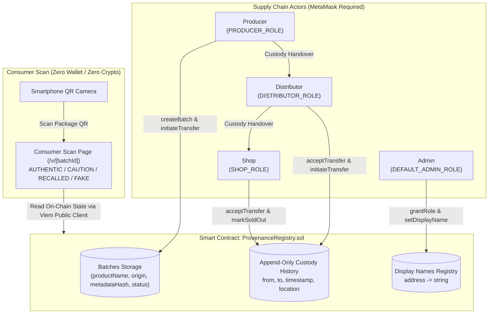

# ProvenanceChain

> A role-based product authenticity and supply chain provenance decentralized application (dApp) powered by Ethereum smart contracts and MetaMask.

---

## 1. Executive Summary & Design Principles

Counterfeit goods—such as specialty coffee, honey, and pharmaceuticals—harm consumers and honest producers. **ProvenanceChain** guarantees product authenticity by enforcing immutable, append-only custody handovers on the Ethereum blockchain.

- **Zero-Friction Consumer Verification**: Consumers scan a QR code (`https://<host>/v/<batchId>`) with any smartphone camera. They see the full journey with a cryptographic authenticity verdict with **no wallet, no app download, and zero crypto**.
- **Role-Enforced On-Chain Supply Chain**: The smart contract strictly enforces valid commercial paths:
  $$\text{Producer} \longrightarrow \text{Distributor} \longrightarrow \text{Shop}$$
  $$\text{Producer} \longrightarrow \text{Shop (Direct)}$$
  Any invalid handovers (e.g., Shop &rarr; Producer or Distributor &rarr; Distributor) are reverted at the EVM contract level.
- **Pure On-Chain Source of Truth**: There is **no centralized database**. All batches, custody events, and business display names are stored directly on the smart contract and queried in real-time via public RPC.

---

## 2. Architecture & Data Flow



---

## 3. Tech Stack

- **Smart Contracts**: Solidity `^0.8.24`, Foundry, OpenZeppelin (`AccessControl`, `Pausable`).
- **Blockchain**: Base Sepolia (`chainId: 84532`) testnet / local Anvil (`chainId: 31337`) dev node.
- **Frontend**: Next.js 14+ (App Router), TypeScript, Tailwind CSS, Lucide icons.
- **Web3 Wallet Client**: MetaMask via `wagmi` + `viem` with injected connector and automatic network switching.
- **No Database**: Pure blockchain state.
- **Testing**: Foundry test suite (unit + fuzz testing), Vitest, and Playwright end-to-end tests.

---

## 4. Setup & Running Locally

### Prerequisites
- Node.js `v18+` and `npm`
- Foundry (`anvil`, `forge`): `curl -L https://foundry.paradigm.xyz | bash && foundryup`

### Installation
```bash
# Clone the repository
git clone https://github.com/your-username/ProvenanceChain.git
cd ProvenanceChain

# Install workspace dependencies
npm install
```

### Start Local Blockchain & Deploy
```bash
# 1. Start Anvil in a background terminal
~/.foundry/bin/anvil --port 8545 --host 0.0.0.0

# 2. Deploy smart contract & seed demo scenarios
npm run seed
```

### Start Web Application
```bash
# Start Next.js development server
npm run dev

# Open in browser: http://localhost:3000
```

---

## 5. Adding Networks to MetaMask

### A. Anvil Localhost (Local Development)
- **Network Name**: `Anvil Localhost`
- **Default RPC URL**: `http://localhost:3000/api/rpc` (or `http://127.0.0.1:8545`)
- **Chain ID**: `31337`
- **Currency Symbol**: `ETH`

### B. Base Sepolia (Public Testnet)
- **Network Name**: `Base Sepolia`
- **RPC URL**: `https://sepolia.base.org`
- **Chain ID**: `84532`
- **Currency Symbol**: `ETH`
- **Block Explorer URL**: `https://sepolia.basescan.org`

---

## 6. Pre-Funded Demo Wallets (Anvil)

| Role | Entity Name | Address | Private Key |
| :--- | :--- | :--- | :--- |
| **Admin** | Platform Administrator | `0xf39Fd6e51aad88F6F4ce6aB8827279cffFb92266` | `0xac0974bec39a17e36ba4a6b4d238ff944bacb478cbed5efcae784d7bf4f2ff80` |
| **Producer** | Sidama Coffee Co-op | `0x70997970C51812dc3A010C7d01b50e0d17dc79C8` | `0x59c6995e998f97a5a0044966f0945389dc9e86dae88c7a8412f4603b6b78690d` |
| **Distributor** | Addis Export Co. | `0x3C44CdDdB6a900fa2b585dd299e03d12FA4293BC` | `0x5de4111afa1a4b94908f83103eb1f1706367c2e68ca870fc3fb9a804cdab365a` |
| **Shop** | Roast & Co. | `0x90F79bf6EB2c4f870365E785982E1f101E93b906` | `0x7c852118294e51e653712a81e05800f419141751be58f605c371e15141b007a6` |

*(Import any of these private keys into MetaMask to test each role).*

---

## 7. Core Demo Story (Under 2 Minutes)

1. **Scan Authentic Batch #1**:
   - Open **[http://localhost:3000/v/1](http://localhost:3000/v/1)**.
   - Result: 🟢 **VERIFIED AUTHENTIC** with 100% complete unbroken custody trail: *Sidama Coffee Co-op &rarr; Addis Export Co. &rarr; Roast & Co.*
2. **Scan Caution Batch #2**:
   - Open **[http://localhost:3000/v/2](http://localhost:3000/v/2)**.
   - Result: 🟡 **CAUTION ADVISED** (batch is still at producer facility; has not reached verified retail shop).
3. **Scan Recalled Batch #3**:
   - Open **[http://localhost:3000/v/3](http://localhost:3000/v/3)**.
   - Result: 🔴 **SAFETY ALERT: RECALLED** with official safety notice (*"Quality seal defect detected in packaging line 4B"*).
4. **Scan Unregistered Code #999**:
   - Open **[http://localhost:3000/v/999](http://localhost:3000/v/999)**.
   - Result: 🔴 **COUNTERFEIT WARNING** (unrecognized batch ID on blockchain).
5. **Create a Batch with MetaMask**:
   - Connect MetaMask on Account #1 (Producer).
   - Navigate to **[http://localhost:3000/producer](http://localhost:3000/producer)**.
   - Enter batch details, confirm in MetaMask, download generated QR code label, and initiate handover to Addis Export Co.!

---

## 8. Why Blockchain? (And Why 2-Step Handover?)

### Why Blockchain?
Centralized databases can be quietly updated, backdated, or purged by administrators or compromised credentials.
- **Append-Only History**: Once a custody event is mined, it cannot be modified or reordered by any party.
- **Public Verifiability**: Any consumer smartphone can independently verify product origin without trusting a proprietary API or vendor database.
- **Separation of Trust**: Producers, export haulers, and retail shops do not need to share a database or trust one central server.

### Why 2-Step Handover (`initiateTransfer` &rarr; `acceptTransfer`)?
In supply chains, unilateral direct transfers allow a malicious sender to "dump" defective or hazardous inventory onto an unsuspecting recipient's address. 
With **2-step handover**:
1. Sender calls `initiateTransfer(batchId, recipient, location)` &rarr; sets `pendingHolder`.
2. Goods are physically received and inspected.
3. Recipient calls `acceptTransfer(batchId, location)` &rarr; updates `currentHolder` and appends the immutable custody event.
4. Sender can call `cancelTransfer(batchId)` if shipment was rerouted before acceptance.

*(Note: Direct transfer mode is also available via `transferCustody` for streamlined automated scenarios).*

---

## 9. Known Limitations & Mitigation

- **Garbage In, Garbage Out**: The blockchain proves that a custody record was not altered after entry; it does not prove that the initial physical batch was genuine.
  - *Mitigation*: Restrict `PRODUCER_ROLE` strictly to vetted and audited organizations.
- **Physical Package Clones**: Counterfeiters could duplicate physical QR codes.
  - *Mitigation*: Physical tamper-evident holographic seals and single-scan velocity checks.

---

## 10. Verification & Test Suite

Run all tests across contracts, shared types, and end-to-end browser flows:
```bash
# Run complete test suite
npm test

# Run contract tests only (Forge)
npm run test:contracts

# Run Playwright E2E browser tests
npm run test:e2e
```
